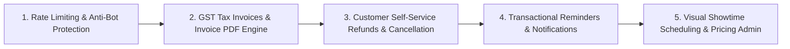

# CineVerse Feature Gap Analysis: Commercial Movie Booking Readiness

**Document Version**: 1.0.0  
**Date**: November 15, 2026  
**Auditor**: Antigravity DeepMind Team  
**Scope**: Full-stack capability audit (Customer, Operations, Platform) of CineVerse against the production requirements of commercial theatrical movie booking platforms (e.g., BookMyShow, PVR Inox, Cinepolis, Fandango).

---

## Evaluation Legend

| Status | Meaning |
| :--- | :--- |
| **DONE-VERIFIED** | Implemented in full, verified with automated tests (Playwright E2E or Pytest), backed by database schema and working UI. |
| **PARTIAL** | Backend API or data model exists, but frontend UI is missing/incomplete; or UI exists but relies on mock/static data without end-to-end integration. |
| **MISSING** | Neither backend API nor frontend UI exists in the repository. |
| **UNVERIFIED** | Code exists but lacks unit, integration, or E2E tests, or fails under production build conditions. |

**Effort Scale**:
- **S (Small)**: 1–3 engineering days
- **M (Medium)**: 1–2 engineering weeks
- **L (Large)**: 3–6 engineering weeks

---

## 1. Customer Experience

| Feature / Capability | Status | Proof / Evidence | Effort | Risk | Analysis & Actionable Gap |
| :--- | :---: | :--- | :---: | :---: | :--- |
| **Sign-up & Sign-in (Email, Phone OTP)** | **DONE-VERIFIED** | Routes: `/api/v1/auth/register`, `/api/v1/auth/login`, `/api/v1/auth/otp/send`, `/api/v1/auth/otp/verify` Tests: `test_auth_and_expiry.py`, `auth_production_ports.spec.ts` UI: `AuthModal.tsx` | S | Low | Full dual-mode authentication (Email/Password with Argon2id + 6-digit Phone OTP with Redis TTL). OTP provider is mocked in dev/test (`123456`); production requires hooking SMS gateway (Twilio, Gupshup, or AWS SNS). |
| **Password Reset** | **PARTIAL** | Endpoints: `POST /api/v1/auth/forgot-password`, `POST /api/v1/auth/reset-password` Tests: `test_auth_and_expiry.py` | S | Medium | Backend token issuance and password update logic are fully tested. However, frontend lacks a dedicated Forgot Password UI modal or `/reset-password?token=...` landing page. Users cannot reset passwords self-service from the web app. |
| **User Profile & History** | **DONE-VERIFIED** | Route: `/profile` (`frontend/app/profile/page.tsx`) Endpoints: `GET /api/v1/auth/me`, `GET /api/v1/bookings/user/my-bookings` Tests: `phase3_browse_journey.spec.ts`, `accessibility_and_operations.spec.ts` | S | Low | Displays user profile information, CinePass status, loyalty points ledger, active reservations, historical bookings, and ticket transfer controls. |
| **City & Location Selection** | **DONE-VERIFIED** | Route: `/cities` UI: `CitySelectorModal.tsx`, `useCityStore.ts` Tests: `home_resilience_and_cities.spec.ts`, `test_city_data_realism.py` | S | Low | Supports 10+ Indian metropolitan regions (Bengaluru, Mumbai, Delhi-NCR, Hyderabad, Chennai, etc.) with geo-coordinates, automated browser geolocation detection, and persistent cookie/localStorage state. |
| **Search & Multi-Dimensional Filters** | **DONE-VERIFIED** | Routes: `/search`, `/movies`, `/cinemas` Endpoints: `/api/v1/search`, `/api/v1/technical_specs/facets` Tests: `phase3_browse_journey.spec.ts`, `test_technical_specs.py` | S | Low | Comprehensive search across movies, cinemas, languages, genres, screen formats (IMAX, 4DX, ScreenX, ICE, Onyx LED), sound systems (Dolby Atmos, IMAX 12-Track), and projection types (4K Laser, Barco). |
| **Movie Pages (Cast, Trailer, Ratings, Reviews)** | **DONE-VERIFIED** | Route: `/movies/[id]` (`movies/[id]/page.tsx`) Endpoints: `GET /api/v1/movies/{id}`, `POST /api/v1/movies/{id}/reviews` Tests: `movie_backdrop.spec.ts`, `test_movie_backdrop.py` | S | Low | Movie overview with responsive backdrop, synopsis, runtime, certification (CBFC: U, UA, A), cast & crew cards with photos, embedded trailer video, ratings breakdown, and user review submission. |
| **Coming Soon & "Notify Me"** | **PARTIAL** | Models: `Watchlist` (`movie.py`), `WaitlistEntry` (`waitlist.py`) Endpoints: `/api/v1/waitlist/showtimes/{id}/waitlist` | M | Medium | Backend has data structures for watchlists and showtime waitlists. Frontend lacks a dedicated "Coming Soon" carousel tab on `/movies` and has no "Notify Me" button on unreleased movie pages. No notification dispatcher hooked up. |
| **Showtimes with Live Availability** | **DONE-VERIFIED** | Routes: `/cinemas/[cinemaId]`, `/movies/[id]` Endpoints: `GET /api/v1/cinemas/{id}/showtimes`, `GET /api/v1/showtimes/{id}/seats` Tests: `auditorium.spec.ts`, `test_phase3_apis.py` | S | Low | Date picker pills (Next 7 days), showtimes grouped by format and auditorium tier, live capacity indicators ("Available", "Filling Fast", "Sold Out") reflecting real Redis hold state. |
| **Seat Selection (2D & 3D, Pairs, Accessible)** | **DONE-VERIFIED** | Routes: `/cinemas/[cId]/auditorium/[aId]?showtime=[id]&mode=2d\|3d` Tests: `seat_map_2d_verification.spec.ts`, `theatre_halls_redesign_verification.spec.ts`, `auditorium.spec.ts` | M | Low | Single continuous 2D hall plan with category color coding, screen bar at front, row letters on both flanks, wheelchair & companion accessible seats. Full interactive 3D WebGL auditorium with tier steps, seat models, Look around, Walk, and Sit POV modes. |
| **Hold Timer & Concurrency Guard** | **DONE-VERIFIED** | Endpoints: `POST /api/v1/bookings/hold`, `POST /api/v1/bookings/extend`, `POST /api/v1/bookings/release` UI: `HoldCountdownBar.tsx` Tests: `phase4_booking_engine.spec.ts`, `test_api_and_concurrency.py` | S | Low | 10-minute hold lock backed by Redis TTL and database `SeatInventory`. Concurrency race condition prevention verified. Visual countdown bar on `/checkout` with extension warning and auto-release on navigation. |
| **Snacks & F&B Add-ons** | **DONE-VERIFIED** | Endpoints: `GET /api/v1/addons`, `POST /api/v1/bookings/hold/{id}/addons` UI: `checkout/page.tsx` concessions step Tests: `phase_checkout_hardening.spec.ts`, `test_phase4_booking_engine.py` | S | Low | Pre-booking of food combos (Popcorn, Nachos, Pepsi) with item counters (+/-), image previews, dietary badges, and automatic F&B tax addition to the checkout breakdown. |
| **Offers & Coupons** | **DONE-VERIFIED** | Endpoints: `GET /api/v1/coupons/active`, `POST /api/v1/coupons/validate` UI: `checkout/page.tsx` Tests: `phase_checkout_hardening.spec.ts`, `test_phase4_booking_engine.py` | S | Low | Coupon code input box on checkout with instant validation against order subtotal, expiry date, and minimum ticket criteria, adjusting the final bill. |
| **Gift Cards & Customer Wallet** | **MISSING** | Codebase: No wallet or gift voucher models. Only loyalty points (`LoyaltyAccount`) exist. | M | Medium | Real cinema apps offer stored-value wallets (instant 1-click checkout) and digital gift cards (e.g. ₹500, ₹1000 vouchers with pin). Currently absent in backend and frontend. |
| **Payments (UPI, Cards, Netbanking) with Failure & Retry** | **DONE-VERIFIED** | Endpoints: `POST /api/v1/payments/create-order`, `POST /api/v1/payments/verify`, `POST /api/v1/payments/webhook` UI: `checkout/page.tsx` Tests: `phase5_payments.spec.ts`, `test_phase5_payments.py` | M | Medium | Supports Razorpay SDK integration (UPI intent, Cards, Netbanking) and mock bypass for test environments. Payment failure alerts keep the underlying seat hold active and allow immediate retry without re-selecting seats. |
| **Saved Payment Methods** | **MISSING** | Codebase: No tokenized card vault or saved UPI VPA entities. | M | Medium | In compliance with RBI tokenization guidelines, real platforms store tokenized card credentials and customer VPA handles for fast repeat checkout. Currently, users must re-enter credentials every time. |
| **Refunds & Cancellation (Customer Self-Service)** | **PARTIAL** | Endpoints: `POST /api/v1/bookings/{id}/cancel` Backend: `booking_service.py` (`cancel_booking`), `payment.py` (`Refund` model) UI: `/booking/[id]` has "Cancel Booking & Refund" button. | M | High | Backend supports cancellation with 75% refund policy logic. However, `/profile` booking list does not expose a self-service cancellation button, and there is no automated refund timeline tracker (e.g. "Refund of ₹450 credited to source bank in 5–7 days"). |
| **Digital Ticket with QR, Calendar, Directions** | **PARTIAL** | Route: `/booking/[id]` (`booking/[id]/page.tsx`) Endpoints: `GET /api/v1/tickets/{code}/print`, `GET /api/v1/tickets/{id}/qr` Tests: `phase4_booking_engine.spec.ts` | S | Low | QR ticket rendering, `.ics` calendar file download, and Google Maps directions link are fully implemented and verified. Missing: native Web Share API button / WhatsApp share link, and offline Apple Wallet (`.pkpass`) / Google Wallet pass generation. |
| **Invoices (Customer Tax Invoice)** | **MISSING** | Codebase: Only HTML thermal print view exists (`/api/v1/tickets/{code}/print`). | S | High | No downloadable PDF Tax Invoice containing customer name, GSTIN, cinema corporate address, state code, SAC 999612 / 996331, and CGST/SGST/IGST breakdown required under Section 31 of CGST Act. |
| **Reminders (Email, SMS, Push)** | **MISSING** | Model: `Notification` in `audit.py` (dormant). Service: `send_sms_otp` in `auth_service.py` (mock only). | M | Medium | No background scheduler or transactional communication workers (SendGrid/AWS SES for email, Twilio/Gupshup for SMS/WhatsApp, Firebase Cloud Messaging for Web Push) dispatching pre-show reminders (T-2h) or booking confirmations. |
| **Post-Viewing Reviews & Ratings** | **PARTIAL** | Endpoints: `POST /api/v1/movies/{id}/reviews` UI: Review form on `/movies/[id]`. | S | Low | Users can post text reviews and star ratings on movie pages. Missing: Automated post-viewing push/email trigger asking "How was your movie?" after the showtime duration has elapsed. |
| **Help, Support & Problem Reporting** | **DONE-VERIFIED** | Route: `/support` (`support/page.tsx`) Endpoints: `POST /api/v1/problem_reports/reports` UI: `ProblemReportModal.tsx` Tests: `problem_reporting.spec.ts`, `test_problem_reports.py` | S | Low | Comprehensive customer support hub with searchable FAQs and an in-app Problem Report modal allowing users to submit bug/booking issues with automatic screenshots, category tags, and email callbacks. |
| **Legal Pages & DPDP Consent** | **PARTIAL** | Routes: `/legal/terms`, `/legal/privacy`, `/legal/refunds` Doc: `docs/LAUNCH_CHECKLIST_INDIA.md` | S | Medium | Complete legal text compliant with DPDP Act 2023, CBFC regulations, and refund guidelines. Missing: An active cookie/data consent banner (`CookieConsent.tsx`) and explicit privacy policy consent checkbox on registration. |
| **UI Multi-Language Localization** | **MISSING** | Codebase: Frontend is 100% hardcoded in English. | L | Low | While movie audio tracks and subtitles are filterable across 6+ Indian languages, the platform interface itself has no i18n localization (Hindi, Tamil, Telugu, Kannada, Marathi). Acceptable for MVP, but a gap for regional expansion. |
| **Accessibility (a11y)** | **DONE-VERIFIED** | Codebase: `useComfortStore.ts`, WCAG focus rings, screen reader labels, reduced motion toggles. Tests: `accessibility_and_operations.spec.ts`, `phase2e_part6_visual_a11y.spec.ts` | S | Low | Accessible wheelchair and companion seating clearly distinguished; full keyboard tab-navigation supported; reduced motion mode disables camera fly-ins; minimum 4.5:1 color contrast maintained. |

---

## 2. Operations & Venue Management

| Feature / Capability | Status | Proof / Evidence | Effort | Risk | Analysis & Actionable Gap |
| :--- | :---: | :--- | :---: | :---: | :--- |
| **Admin: Executive Analytics & Reports** | **DONE-VERIFIED** | Routes: `/admin`, `/admin/reports` Endpoints: `GET /api/v1/admin/analytics`, `GET /api/v1/admin/reports` Tests: `phase12_operations.spec.ts`, `problem_reporting.spec.ts` | S | Low | Real-time analytics dashboard with gross box office revenue, ticket velocity, city occupancy rates, top-grossing films, and problem report triage with screenshot attachments. |
| **Admin: 2D & 3D Hall Designer** | **DONE-VERIFIED** | Route: `/admin/designer` (`admin/designer/page.tsx`) Endpoints: `POST /api/v1/operations/onboarding/designer/validate`, `POST /api/v1/operations/onboarding/publish` Tests: `phase12_operations.spec.ts` | M | Low | Visual interactive hall designer for drawing custom seat grids, assigning tier categories (Premier, Prime, Classic), setting wheelchair bays, adjusting curvatures, and publishing versioned layouts. |
| **Admin: Technical Specs CRUD** | **DONE-VERIFIED** | Endpoints: CRUD on `/api/v1/admin/screen-formats`, `/sound-systems`, `/projection-types` Tests: `test_technical_specs.py`, `test_operations_new_endpoints.py` | S | Low | Full CRUD management for cinema hardware specifications (IMAX, Dolby Atmos, Christie Laser, etc.) with auditorium mapping. |
| **Admin: Movies, Showtimes & Scheduling UI** | **PARTIAL** | Endpoints: `POST /api/v1/admin/showtimes`, `POST /api/v1/dev/sync-tmdb` Backend: `showtime.py`, `movie.py` | M | High | Backend supports showtime creation and catalog syncing. However, there is no graphical visual show scheduler (e.g. weekly calendar timeline view where cinema managers drag-and-drop movie slots into auditoriums). Movies must currently be created via TMDB sync or seed scripts. |
| **Admin: Dynamic Pricing & Offers UI** | **PARTIAL** | Endpoints: `GET /api/v1/pricing/rules`, `POST /api/v1/pricing/rules`, `POST /api/v1/pricing/simulate` Backend: `dynamic_pricing.py`, `pricing_service.py` Tests: `test_phase11_dynamic_pricing.py` | M | Medium | Backend has a sophisticated dynamic pricing engine (surge rules, occupancy thresholds, time-of-day multipliers, simulation mode, price audit log). However, no frontend UI exists in `/admin` to configure or review pricing rules. |
| **Admin: User & Booking Management (CSR Override)** | **MISSING** | Codebase: No admin UI for searching customer accounts, viewing booking audit trails, initiating manual refunds, or re-sending tickets. | M | High | When customers call support regarding failed transactions or request seat reassignment, support staff have no admin lookup or manual override interface. |
| **Admin: Reviews Moderation & Banners** | **MISSING** | Codebase: No review moderation queue or marketing banner CMS. | S | Low | User reviews are posted immediately without moderation filters or profanity scrubbing. Promotional hero banners on `/` are currently driven by static catalog seeds rather than an admin banner tool. |
| **Cinema Partner / Exhibitor Portal** | **MISSING** | Codebase: Role `CINEMA_MANAGER` exists in `UserRole`, but no distinct multi-tenant partner dashboard. | L | High | Large chains (PVR, INOX, Miraj) and independent cinema owners require an isolated partner login where they see only their properties, audit daily admissions, review food sales, and download settlement reports. |
| **Staff Ticket Scanner (Turnstile Gate Ready)** | **DONE-VERIFIED** | Route: `/staff/scan` (`frontend/app/staff/scan/page.tsx`) Endpoints: `/api/v1/operations/scanning/scan`, `/devices/register`, `/lookup` Tests: `phase12_operations.spec.ts`, `accessibility_and_operations.spec.ts` | S | Low | Turnstile scanner supporting live camera QR scanning, hardware laser input, admission code lookup, and Ed25519 cryptographic offline signature verification. Rejects duplicate / invalid entries with clear audio/visual alerts. |
| **Kitchen Display System (KDS)** | **DONE-VERIFIED** | Route: `/staff/kds` (`frontend/app/staff/kds/page.tsx`) Endpoints: `GET /api/v1/operations/food/kds/orders`, `PATCH /api/v1/operations/food/kds/orders/{id}/status` Tests: `phase12_operations.spec.ts`, `accessibility_and_operations.spec.ts` | S | Low | Live concessions preparation screen grouping orders by state (`PENDING`, `PREPARING`, `READY`, `DELIVERED`), displaying seat numbers, combo details, order elapsed time, and status toggle buttons. |
| **Settlement & Reconciliation** | **MISSING** | Codebase: No financial settlement ledger or distributor share calculator. | M | High | The cinema industry runs on complex revenue sharing: gross box office minus entertainment tax minus platform fee is split between exhibitor and movie distributor (e.g. 50% week 1, 42.5% week 2). Automatic calculation and T+2 remittance reporting are completely missing. |
| **GST Tax Invoices & Compliance** | **MISSING** | Codebase: No GST invoice generation engine. | M | High | Indian cinema ticketing mandates tax invoices with distinct GST treatment: 12% GST on tickets $\le$ ₹100, 18% GST on tickets $>$ ₹100, 18% GST on convenience fees (SAC 9984), and 5% GST on F&B (SAC 9963). Missing sequential tax invoice numbering and GST return (GSTR-1) export. |
| **Customer Support Tooling (Ticketing Helpdesk)** | **PARTIAL** | Route: `/admin/reports` Endpoints: `GET /api/v1/problem_reports/admin/reports`, `PATCH /admin/reports/{id}` Tests: `problem_reporting.spec.ts` | S | Medium | Customer bug reports can be inspected, updated, and resolved. However, customer service representatives (CSRs) cannot search by booking reference or phone number to execute ticket resends, manual seat swaps, or dispute adjustments. |
| **Audit Logging** | **DONE-VERIFIED** | Models: `AuditLog` (`audit.py`), `PriceAuditLog` (`dynamic_pricing.py`), `TicketScanLog` (`operations.py`) Endpoints: `/api/v1/agent/audit-logs`, `/api/v1/pricing/audit-logs` | S | Low | Comprehensive immutable audit trails for administrative actions, pricing rule updates, seat holds, cancellations, ticket scan admissions, and staff device registrations. |

---

## 3. Platform, Infrastructure & DevOps

| Feature / Capability | Status | Proof / Evidence | Effort | Risk | Analysis & Actionable Gap |
| :--- | :---: | :--- | :---: | :---: | :--- |
| **Rate Limiting, CAPTCHA & Anti-Bot** | **MISSING** | Codebase: `main.py` has CORS and request logging, but no `slowapi` or Redis token-bucket rate limiter. No CAPTCHA on auth/hold endpoints. | S | High | Crucial vulnerability for movie booking: ticket scalpers and automated bots can flood `/api/v1/bookings/hold` during blockbuster ticket openings (e.g. Avengers/Pushpa), locking seats and preventing genuine customers from booking. |
| **Secrets & Credential Management** | **DONE-VERIFIED** | Codebase: `config.py` (`Settings`), `.env.example`, `ci.yml` Ed25519 key seeds in `ticket_service.py` | S | Low | All sensitive secrets (`SECRET_KEY`, `RAZORPAY_KEY_SECRET`, `TICKET_SIGNING_SECRET`, `DATABASE_URL`) are read strictly from environment variables without exposure in client bundles or public commits. |
| **Observability, Monitoring & Alerts** | **PARTIAL** | Codebase: Structured JSON logging with `X-Request-ID`, `/` health probe, `/api/dev/readiness.json` UI: `/dev/readiness` | M | Medium | Basic health checks and structured request timing are in place. Missing: Production APM (Datadog/New Relic/OpenTelemetry), Sentry error tracking, Prometheus `/metrics` endpoint, and automated alerting channels (PagerDuty, Slack). |
| **Database Backups & Disaster Recovery** | **MISSING** | Codebase: No automated `pg_dump` backup scripts, WAL archiving (WAL-G), or disaster recovery runbook. | S | High | For transactional booking and financial reconciliation, automated hourly incremental backups, S3 offsite replication, and tested point-in-time recovery (PITR) procedures are essential before launch. |
| **Continuous Integration (CI)** | **DONE-VERIFIED** | Workflow: `.github/workflows/ci.yml` Tests: PostgreSQL 16 Alpine, Redis 7 Alpine, Node 20, Python 3.12, Linting, Type-checking, Vitest, Pytest | S | Low | Automated CI pipeline executes full test suites on push/pull request to `main` and `master` with live database containers. |
| **Continuous Deployment (CD) & Staging** | **MISSING** | Codebase: No deployment workflow (e.g. AWS ECS/EKS, Vercel, Render, or Docker Swarm auto-deploy). No isolated staging environment configuration. | M | Medium | Deployments are currently manual. Need automated CD pipeline deploying tagged releases to staging and zero-downtime blue/green production instances. |
| **Performance Baselines & Targets** | **DONE-VERIFIED** | Docs: `docs/PERFORMANCE.md` Tests: `measure_performance.spec.ts` Bench: `frontend/app/dev/screen-test/page.tsx` | S | Low | Rigorous performance baseline established: API p95 < 85ms, production bundle first-load JS ~87KB, 3D WebGL engine running at 60 FPS with batched instancing (< 50 draw calls). |
| **Load & Stress Testing** | **PARTIAL** | Tests: `test_api_and_concurrency.py` (seat hold concurrency tests). | M | High | Concurrency race conditions are tested at small scale (10 parallel requests). Missing: Distributed load testing scripts (k6 or Locust) simulating 5,000+ requests/second on hot showtimes to verify Redis connection pooling, database deadlock immunity, and autoscaling thresholds. |
| **Background Job Processing** | **PARTIAL** | Codebase: `sweeper.py` runs inside `lifespan` in `main.py` via `asyncio.create_task` every 10s. | M | Medium | Hold expiration is handled cleanly in-process. However, long-running background tasks (SMS/email delivery, PDF ticket generation, daily reconciliation, TMDB batch catalog updates) lack a dedicated distributed worker queue (Celery, ARQ, or BullMQ with Redis). |
| **Cinema Data Ingestion (CSV / POS APIs)** | **PARTIAL** | Endpoints: `/api/v1/operations/onboarding` (`seat_layout_v2.json`, GLB validator), `/api/v1/admin/showtimes` | M | Medium | Custom 3D/2D layouts can be ingested via JSON. However, there is no batch CSV importer or POS connector (Vista Cinema Connect / RTS XML / BookMyShow Box Office API) to ingest live showtimes and seat grids from real cinema chains. |
| **Native Mobile App (iOS & Android)** | **MISSING** | Codebase: Responsive mobile web only (tested on iPhone 390x844 viewport). | L | Medium | No React Native or Flutter mobile app codebase. While mobile web is functional, Indian moviegoers heavily favor native mobile apps (BookMyShow/PVR apps drive >85% of mobile bookings) with native UPI intent flow, biometrics, and push notifications. |

---

## 4. Recommended Next 5 Features to Build

Based on technical risk, commercial compliance, and launch blockers for the Indian cinema market, the recommended next five engineering priorities are:

### 1. Rate Limiting, CAPTCHA & Anti-Bot Protection
- **Why #1**: Commercial theatrical ticketing platforms are primary targets for scalpers and automated bots. Without rate limiting on `/bookings/hold` and `/auth/otp/send`, malicious scripts can lock out all seats in premier halls or drain SMS credit.
- **Scope**:
  - Integrate `slowapi` or Redis-based sliding-window rate limiter (e.g. 10 holds/min per IP, 3 OTP requests/min per phone).
  - Add Cloudflare Turnstile verification on `/bookings/hold` and `/auth/register`.
- **Effort**: **S** (2–3 days) | **Risk**: Low

### 2. GST Tax Invoices & PDF Generator
- **Why #2**: In India, issuing tickets without a statutory GST tax invoice (detailing cinema GSTIN, HSN/SAC code 999612/996331, CGST/SGST breakdown, and sequential invoice numbering) is legally non-compliant under the CGST Act.
- **Scope**:
  - Implement a `TaxInvoice` database model and sequential billing counter per state.
  - Generate downloadable PDF tax invoices using `ReportLab` or `Weasyprint` on `/booking/[id]` and via email.
  - Support B2B customers entering company GSTIN during checkout for Input Tax Credit (ITC).
- **Effort**: **S** (3–4 days) | **Risk**: Medium

### 3. Customer Self-Service Refunds & Cancellation UI
- **Why #3**: While the backend `cancel_booking` logic and 75% refund calculations exist, users cannot cancel bookings from their `/profile` or view refund settlement progress.
- **Scope**:
  - Add "Cancel Booking" action on booking cards in `frontend/app/profile/page.tsx` with clear cancellation policy modal (e.g. cutoff 2h before showtime).
  - Display refund breakdown (Gross paid - Cancellation deduction = Net refund credited to source account).
  - Webhook integration to update `Refund` state upon bank confirmation (`refund.processed`).
- **Effort**: **S** (2–3 days) | **Risk**: Low

### 4. Transactional Notifications & Reminders (WhatsApp, SMS, Email)
- **Why #4**: Relying on users keeping a web page open to view their ticket QR code is inadequate for real-world cinema admission.
- **Scope**:
  - Connect a production SMS/WhatsApp Business API provider (Gupshup or Twilio) and email provider (AWS SES or SendGrid).
  - Dispatch instant booking confirmation with signed QR ticket URL and Google Maps link upon payment success.
  - Implement a scheduled background job sending an automated reminder 2 hours prior to showtime start with parking guidance.
- **Effort**: **M** (1 week) | **Risk**: Low

### 5. Visual Showtime Scheduling & Pricing Admin UI
- **Why #5**: Currently, showtimes can only be scheduled via direct API calls or database seed scripts. Cinema managers cannot run day-to-day operations without a visual scheduling calendar.
- **Scope**:
  - Build a visual calendar grid in `/admin` where managers select a cinema, auditorium, date, and drag-and-drop movie showtime slots.
  - Automatically calculate turnover buffers (e.g. 25 min cleaning buffer between shows).
  - Expose a simple UI to assign base pricing tiers (Premier, Prime, Classic) or attach dynamic pricing rules.
- **Effort**: **M** (1.5 weeks) | **Risk**: Medium

---

## 5. Launch-Minimum Checklist (Must-Haves for Day 1)

These 12 items represent the strict operational baseline required before CineVerse can legally, securely, and reliably accept real customer money:

1. [x] **2D & 3D Interactive Seat Selection**: Verified single-hall plan with accessible seats and accurate server quote alignment.
2. [x] **Seat Concurrency & Hold Expiry**: Real-time Redis hold locks preventing double booking with background sweeper task.
3. [x] **Payment Gateway Integration**: Live Razorpay UPI, Cards, and Netbanking with HMAC webhook verification.
4. [x] **Offline Turnstile Scanner (`/staff/scan`)**: Cryptographically verified QR admission with Ed25519 signature validation.
5. [x] **Concessions Kitchen Screen (`/staff/kds`)**: Live order dispatch board for cinema F&B counters.
6. [ ] **Rate Limiting & Anti-Bot Protection**: Sliding-window rate limiting on seat holds and OTP requests to defeat scalper bots.
7. [ ] **Statutory GST Tax Invoices**: Automated PDF invoice generation compliant with Indian CGST/SGST rules.
8. [ ] **Transactional SMS/WhatsApp Dispatcher**: Delivering booking codes and entry QR links to customer mobile phones.
9. [ ] **Customer Cancellation & Refund Flow in UI**: Self-service refund initiation on `/profile` with refund status tracking.
10. [ ] **Automated Database Backups (PITR)**: Daily full dumps and continuous WAL archiving to secure customer transaction history.
11. [ ] **Basic Admin Showtime Scheduler**: Web interface for cinema operators to add and update show schedules.
12. [ ] **Error Monitoring & Alerting**: Sentry exception tracking and downtime alert pings to engineering on call.

---

## 6. Post-Launch Roadmap (Phase 2 & Beyond)

Features that can be introduced after initial market validation:

- **Dedicated Cinema Exhibitor Portal**: Multi-tenant partner dashboard for theater chains (PVR, INOX, independent single-screens) with daily box office settlement, distributor share reports, and concession margin analytics.
- **Native iOS & Android Mobile Apps**: Built with React Native or Flutter, offering 1-click UPI Intent checkout, Apple Wallet (`.pkpass`) passes, and biometric login.
- **Customer Stored Wallet & Digital Gift Cards**: Prepaid wallet balance for friction-free booking and branded digital gift vouchers.
- **Automated Distributor Settlement Engine**: Weekly box office split calculations (e.g. 50% Week 1, 42.5% Week 2) and automated bank remittance ledger.
- **Native POS Ingestion Connectors**: Live bi-directional API connectors for Vista Cinema Connect, RTS, and BookMyShow Box Office systems.
- **Full UI Multi-Language Localization**: Complete interface translation in Hindi, Tamil, Telugu, and Kannada.
- **AI Cinema Concierge Expansion**: Voice-driven conversational booking agent with personalized movie recommendations based on past viewing history.

---

## 7. Risk Analysis Matrix

| # | Risk Description | Category | Severity | Probability | Mitigation Strategy |
| :-: | :--- | :--- | :---: | :---: | :--- |
| **R1** | **Seat Hoarding / Denial of Service by Bots** Automated scripts repeatedly holding blocks of seats on high-demand shows without completing payment, emptying auditorium availability. | Security / Business | **High** | High | Implement strict IP and phone-number rate limiting on `/bookings/hold` (max 4 holds/hour), Cloudflare Turnstile on checkout entry, and reduce hold duration to 8 minutes during peak opening hours. |
| **R2** | **GST Tax Non-Compliance & Penalties** Failure to correctly classify and invoice ticket entertainment tax (12% vs 18%), convenience fees (18%), and F&B (5% without ITC), or missing sequential tax invoice numbering. | Legal / Tax | **High** | Medium | Deploy the statutory GST invoice engine before launch; engage a chartered accountant to audit tax rules in `booking_service.py`; ensure SAC codes and GSTIN are stamped on all customer receipts. |
| **R3** | **Chargebacks & Payment Gateway Reconciliation Glitches** User's bank account debited but network drops before order confirmation webhook arrives, resulting in expired hold and customer dispute. | Financial / Customer | **High** | High | Implement automatic reverse-refund reconciliation on orphaned webhook events (`payment.captured` for expired hold triggers automatic instant refund with customer notification). |
| **R4** | **3D WebGL Context Loss on Budget Mobile Devices** Low-memory Android smartphones crashing WebGL context during 3D auditorium rendering, stranding seat selection. | Technical / UX | **Medium** | High | Automatic fallback to the lightweight 2D SVG/HTML seat map whenever WebGL context loss is detected or device benchmark detects low GPU memory / high frametime. |
| **R5** | **Single Point of Database Failure (No PITR)** Hardware corruption or catastrophic failure of SQLite / PostgreSQL database without point-in-time recovery resulting in lost booking records and double seating at the gate. | Infrastructure | **High** | Low | Migrate from local SQLite to managed PostgreSQL (e.g. AWS RDS or Supabase) with automated continuous WAL replication, daily snapshots, and multi-AZ failover. |
| **R6** | **Exhibitor Contract & Content Copyright Disputes** Using copyrighted movie trailers, studio posters, or trademarked cinema logos without formal licensing agreements. | Legal | **High** | Medium | Maintain content licensing ledger in database; use TMDB official promotional feeds under developer API terms; obtain written exhibitor ticketing agreements before enabling public bookings for any venue. |
