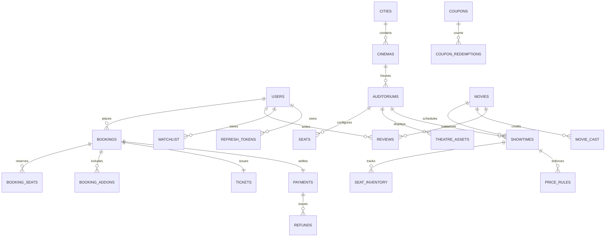

# CineVerse Database Architecture & Schema

## 1. Relational Schema Overview

CineVerse utilizes SQLAlchemy 2.0 async models with support for both PostgreSQL 18 (production `asyncpg`) and SQLite (zero-config local development `aiosqlite`).

---

## 2. Core Entities & Tables

### 2.1 Identity & Access (`users`, `refresh_tokens`)
- `users`: Stores user identity, hashed passwords (bcrypt), mobile numbers, preferred city, and RBAC roles (`customer`, `cinema_manager`, `support`, `admin`).
  - Constraints: Unique index on `email`, unique index on `phone`.
- `refresh_tokens`: Cryptographic refresh tokens for JWT rotation.
  - Columns: `id`, `user_id`, `token`, `expires_at`, `revoked`.

### 2.2 Geography & Exhibition Hierarchy (`cities`, `cinemas`, `auditoriums`, `seats`)
- `cities`: Metropolitan service areas (Bengaluru, Mumbai, Delhi NCR, Hyderabad, Chennai, Pune, Kolkata).
- `cinemas`: Theatres with postal address, facilities (IMAX, 4DX, Dolby Atmos, Recliners), and cancellation refund terms.
- `auditoriums`: Individual screening halls specifying physical screen dimensions, aspect ratios, and total capacity.
- `seats`: 3D physical seats mapped 1-to-1 to the GLTF model.
  - Columns: `seat_id` (e.g. `A01`, `F05`), `node_name` (e.g. `seat_F_05`), `row`, `number`, `category` (Front, Prime, Premier), `position_x/y/z`, `eye_x/y/z`, `screen_distance`, `horizontal_angle_deg`, `vertical_angle_deg`.

### 2.3 Catalog & Programming (`movies`, `movie_cast`, `showtimes`, `price_rules`)
- `movies`: Title, slug, synopsis, certificate (`U`, `UA`, `A`), run duration, poster and banner image paths, trailer YouTube URLs, aggregate ratings, and interested count.
- `showtimes`: Links a movie to an auditorium at a specific timestamp.
  - Columns: `movie_id`, `auditorium_id`, `start_time`, `end_time`, `format` (IMAX 3D, 4DX, 2D Atmos), `language`.
- `price_rules`: Dynamic tier pricing per showtime (Front ₹280, Prime ₹380, Premier ₹450).

### 2.4 Live Inventory & Concurrency (`seat_inventory`)
- `seat_inventory`: High-frequency transactional table representing seat state for a showtime.
  - Columns: `id`, `showtime_id`, `seat_id`, `category`, `price`, `status` (`AVAILABLE`, `HELD`, `BOOKED`, `PAYMENT_PENDING`), `hold_id`, `hold_expires_at`, `booking_id`.
  - Indexes: Composite unique constraint on `(showtime_id, seat_id)`. Indexes on `hold_id`, `status`, and `hold_expires_at` for sub-millisecond sweeper queries.

### 2.5 Bookings, Concessions & Payments (`bookings`, `booking_seats`, `booking_addons`, `fnb_items`, `payments`, `tickets`, `coupons`)
- `bookings`: Master order record with unique `booking_code` (e.g. `CV-882941`).
  - Columns: `total_ticket_amount`, `convenience_fee`, `gst_amount`, `addons_amount`, `discount_amount`, `final_total_amount`, `status` (`PENDING`, `CONFIRMED`, `CANCELLED`, `EXPIRED`).
- `tickets`: Issued upon payment confirmation with `ticket_number`, cryptographic `hmac_signature`, and `qr_code_url` (data URI PNG).
- `payments`: Razorpay transaction state tracking (`razorpay_order_id`, `razorpay_payment_id`, `razorpay_signature`, `status`).
- `refunds`: Logs processed cancellation refunds (standard 75% reimbursement).
- `coupons` & `coupon_redemptions`: Discount rules engine tracking individual usage counts and maximum redemption caps per user.

